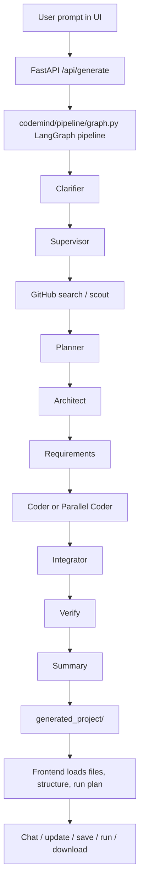

# Project Workflow and Structure

## What this project is

This project is an AI-assisted project generator and editor.

It takes a user prompt, plans the project, generates or adapts files, validates the result, exposes the project in a web UI, and lets the user chat with or update the generated code later.

In simple terms:

1. User describes what they want.
2. Backend turns that into a project plan.
3. An agent pipeline creates files or adapts an existing repo.
4. The system validates the output and stores project state.
5. The frontend shows files, terminal output, run commands, and chat.

---

## High-Level Workflow



The same pipeline is also reused for:

- updating an existing project
- resuming a failed or interrupted generation
- importing uploaded projects
- running code inside the project workspace

---

## Main Runtime Entry Points

### `run.py`

This is the launch script.

- Starts `uvicorn`
- Loads `codemind.api.server:app`
- Supports reload mode through `UVICORN_RELOAD`

### `codemind/api/server.py`

This is the main FastAPI application.

It provides:

- project generation
- project update/resume
- chat with project context
- file save and download
- project import/upload
- run/stop and terminal websockets
- live streaming of generation events

### `codemind/pipeline/graph.py`

This is the orchestration engine.

It builds a LangGraph pipeline made of multiple AI roles such as:

- clarifier
- supervisor
- github_search
- planner
- architect
- requirements
- github_scout
- adapter
- repo_finalize
- coder
- parallel_coder
- update_coder
- integrator
- verify
- summary

### `frontend/`

This is the React UI that talks to the backend.

It is a Vite app and uses WebSockets plus REST APIs to show:

- project list
- file tree
- code editor
- terminal
- assistant chat
- run controls

---

## Backend Workflow In Detail

### 1. Project creation

The frontend sends a prompt to:

- `POST /api/generate`

In `codemind/api/server.py`, this creates a new `thread_id`, stores a `ProjectGeneration` row in SQLite, and starts the generation pipeline in the background.

### 2. Planning and orchestration

The generation logic lives in `codemind/pipeline/graph.py`.

The pipeline typically does this:

1. `clarifier_agent`
   - rewrites vague prompts into a clearer request
2. `supervisor_agent`
   - decides the next step in the pipeline
3. `github_search_agent`
   - searches GitHub for a relevant base repository when needed
4. `planner_agent`
   - creates a structured plan with name, description, tech stack, features, and files
5. `architect_agent`
   - converts the plan into file-by-file implementation tasks
6. `requirements_agent`
   - determines Python or npm dependencies
7. `github_scout_agent`
   - downloads or analyzes a selected repo when a base project is used
8. `adapter_agent`
   - adapts the repository to the requested feature set
9. `repo_finalize_agent`
   - finishes repository-level adjustments
10. `coder_agent` or `parallel_coder_agent`
   - writes the actual files
11. `integrator_agent`
   - connects the individual files together
12. `verify_agent`
   - runs checks and validates the output
13. `summary_agent`
   - finalizes the run

### 3. Output location

Generated code is written into:

- `generated_project/<thread_id>/`

That folder becomes the working project for:

- viewing files
- editing files
- running commands
- downloading the full result

### 4. Validation

The project is checked by:

- `codemind/services/pipeline_validation.py`
- `codemind/core/runtime_detection.py`
- `codemind/services/project_ops.py`

These modules help with:

- import validation
- placeholder detection
- runtime health checks
- run command inference
- safe zip import/export
- snapshot/restore support

### 5. User interaction after generation

The frontend can:

- show the project tree
- open and edit files
- save changes back to the backend
- run the generated app
- open a terminal over WebSocket
- chat with the project using project context
- trigger an update run from chat

---

## Frontend Workflow

### Main UI flow

`frontend/src/main.jsx` boots the React app and loads `App.jsx`, which renders `AppShell`.

`AppShell` coordinates:

- project history
- current project state
- file editor
- terminal panel
- assistant panel
- sidebar panels
- streaming updates from the backend

### Important frontend modules

- `frontend/src/services/api.js`
  - wraps REST calls and WebSocket connections
- `frontend/src/hooks/useProjects.js`
  - loads and refreshes project history
- `frontend/src/hooks/useProjectStream.js`
  - listens to `/ws/stream/{thread_id}`
- `frontend/src/services/projectUtils.js`
  - builds file trees, run commands, formatting, and utility helpers
- `frontend/src/components/EditorWorkspace.jsx`
  - embeds CodeMirror for editing generated files
- `frontend/src/components/TerminalPanel.jsx`
  - embeds xterm.js and connects to `/ws/terminal/{thread_id}`
- `frontend/src/components/AssistantPanel.jsx`
  - provides chat and update approval
- `frontend/src/components/ProjectSidebar.jsx`
  - shows recent projects, file tree, run actions, and settings

### What the frontend libraries do

- `react` / `react-dom`
  - UI rendering
- `vite`
  - development server and production build
- `codemirror`
  - code editor
- `@xterm/xterm`
  - terminal UI
- `@xterm/addon-fit`
  - terminal resize handling
- `lucide-react`
  - icons

---

## Backend Libraries And Tools

### Core backend libraries

- `FastAPI`
  - API server
- `uvicorn`
  - ASGI server
- `SQLAlchemy`
  - database access
- `Pydantic`
  - data validation and structured models
- `LangChain`
  - LLM tool binding and agent support
- `LangGraph`
  - multi-step pipeline orchestration
- `sqlite3`
  - checkpoint and session storage
- `dotenv`
  - environment loading

### LLM providers used by the pipeline

The project supports multiple model backends, with the main orchestration code prepared to use several providers depending on configuration:

- NVIDIA AI Endpoints
- Groq
- Fireworks
- Mistral
- Cerebras
- OpenRouter
- Hugging Face

### Agent tools used by `codemind/pipeline/graph.py`

From `codemind/pipeline/agent_tools.py`, the pipeline uses sandboxed utilities such as:

- `write_file`
- `read_file`
- `list_files`
- `list_project_tree`
- `tree_graph`
- `get_current_directory`
- `run_cmd`
- `ddg_search`
- `delete_file`
- `replace_file_content`
- `apply_patch_block`
- `validate_imports`

These tools let the AI agent inspect and modify the project safely.

---

## Main Functions By Module

### `codemind/api/server.py`

Important functions and routes:

- `_get_graph()`
  - lazy-loads the LangGraph module
- `_make_chat_llm()`
  - creates the chat model instance
- `get_chat_llm()`
  - returns the cached chat LLM
- `run_project_generation()`
  - runs the generation pipeline in the background
- `_build_project_structure()`
  - creates a tree representation for the UI
- `_build_project_context()`
  - prepares file and history context for chat
- `get_chat_tools()`
  - exposes file/tree/update tools to assistant chat

Routes:

- `POST /api/generate`
- `POST /api/projects/{thread_id}/update`
- `POST /api/projects/{thread_id}/resume`
- `POST /api/projects/upload`
- `POST /api/projects/{thread_id}/chat`
- `GET /api/projects`
- `GET /api/projects/{thread_id}`
- `DELETE /api/projects/{thread_id}`
- `POST /api/projects/{thread_id}/file`
- `GET /api/projects/{thread_id}/download`
- `POST /api/projects/{thread_id}/run`
- `POST /api/projects/{thread_id}/stop`
- `WS /ws/stream/{thread_id}`
- `WS /ws/terminal/{thread_id}`

### `codemind/pipeline/graph.py`

Important orchestration helpers:

- `build_graph()`
  - builds the LangGraph state machine
- `run_pipeline()`
  - runs a fresh generation
- `resume_pipeline()`
  - continues an existing run
- `get_run_state()`
  - loads saved graph state
- `prewarm_llm_models()`
  - optionally loads model backends early

### `codemind/services/project_ops.py`

Important helpers:

- `reset_directory()`
- `extract_project_zip()`
- `import_project_files()`
- `create_project_snapshot()`
- `restore_project_snapshot()`

### `codemind/core/runtime_detection.py`

Important helpers:

- `detect_python_app_file()`
- `build_run_plan()`

### `codemind/services/env_sync.py`

Important helper:

- `auto_fill_project_env()`

This module copies matching environment values into generated projects so they can run locally without hardcoding secrets.

### `codemind/services/pipeline_validation.py`

Important helpers:

- `build_generated_file_manifest()`
- `extract_file_info()`
- `scan_placeholders()`
- `scan_runtime_env_placeholders()`
- `validate_project_imports()`
- `run_runtime_health_check()`

### `codemind/core/database.py`

Important pieces:

- `ProjectGeneration`
  - stores prompt, status, and timestamps
- `get_db()`
  - FastAPI DB dependency
- `init_database()`
- `verify_database_health()`
- `transactional_session()`

---

## Templates Used For Generating Projects

The `templates/` folder is the starter library for project generation and repo copying.

### Templates currently present

- `templates/react-vite`
- `templates/nextjs-app`
- `templates/fastapi`
- `templates/fastapi-sqlite`
- `templates/python-tkinter-sqlite`
- `templates/streamlit-app`
- `templates/electron-react-app`

### How templates are used

The workflow uses templates in two main ways:

1. `scripts/scaffold_templates.py`
   - creates or refreshes starter template folders
2. `codemind/services/project_runner.py`
   - copies a template into a target project when appropriate

`codemind/services/project_runner.py` checks the project type and decides whether the project should be treated as:

- `react-vite`
- `nextjs-app`
- `electron-react-app`
- `fastapi`
- `streamlit-app`
- `python-tkinter-sqlite`

### Template generation examples

- `react-vite`
  - created with `create-vite`
- `nextjs-app`
  - created with `create-next-app`
- `fastapi`
  - minimal FastAPI starter with `requirements.txt` and `main.py`
- `fastapi-sqlite`
  - FastAPI starter with SQLite-oriented files
- `electron-react-app`
  - desktop app template with Electron main process plus React UI

### Why templates matter

Templates give the generator:

- a known folder structure
- a working entrypoint
- dependency defaults
- framework-specific boilerplate
- a faster path from prompt to runnable project

---

## Project Folder Structure

Here is the important structure of the repo, ignoring large generated artifacts like `node_modules`, `.next`, and databases:

```text
College_project/
|-- codemind/
|   |-- api/
|   |   |-- server.py
|   |   `-- ui_events.py
|   |-- core/
|   |   |-- database.py
|   |   |-- runtime_detection.py
|   |   |-- schemas.py
|   |   |-- structured_output.py
|   |   `-- template_registry.py
|   |-- pipeline/
|   |   |-- agent_tools.py
|   |   |-- graph.py
|   |   `-- prompt.py
|   |-- services/
|   |   |-- env_sync.py
|   |   |-- github_scout.py
|   |   |-- pipeline_validation.py
|   |   |-- project_context.py
|   |   |-- project_ops.py
|   |   `-- project_runner.py
|   |-- paths.py
|   |-- runner.py
|   `-- __main__.py
|-- docs/
|-- frontend/
|   |-- src/
|   |   |-- components/
|   |   |-- hooks/
|   |   `-- services/
|   |-- index.html
|   |-- package.json
|   `-- vite.config.js
|-- generated_project/      # runtime output (one demo is committed)
|-- scripts/
|   `-- scaffold_templates.py
|-- static/
|-- templates/
|   |-- api/
|   |-- dashboard/
|   |-- desktop/
|   `-- webapp/
|-- tests/
|-- run.py
|-- pyproject.toml
`-- uv.lock
```

### Runtime/generated folders

These are created during execution or used as working state:

- `generated_project`
- `projects.db`
- `pipeline_checkpoints.db`
- `.project_snapshots`
- `run_session.json`

---

## What Each Major Folder Is For

### `frontend/`

The browser app.

It is the control center for:

- project creation
- project browsing
- code editing
- terminal interaction
- assistant chat

### `templates/`

Starter project blueprints.

They are used when generating or adapting different project types.

### `static/`

Served assets, including built frontend output.

### `tests/`

Validation and regression tests.

### `.github/workflows/`

CI pipeline for automated checks.

### `.project_snapshots/`

Rollback snapshots of generated projects before updates.

---

## Recommended Explanation You Can Give To Someone

You can describe this project like this:

> This is an AI project generator and editor. A user gives a prompt, the backend plans the app, searches for a good base repo if needed, selects a template, generates files with agent tools, validates everything, and stores the result in a project workspace. The frontend shows the code, terminal, run commands, and an assistant chat, so the user can edit or update the project after generation.

If you want it even shorter:

> It is a FastAPI + React platform that turns prompts into runnable projects using a LangGraph AI pipeline and reusable templates.

---

## One-Line Summary

`D:\project` is an AI-powered project generation studio built with FastAPI, LangGraph, React, Vite, SQLite, and reusable templates for different project types.
